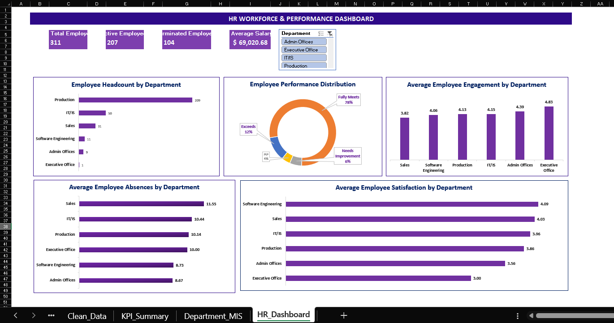

# HR Workforce & Performance MIS Reporting System

An Excel-based HR Management Information System (MIS) that summarizes workforce headcount, employment status, department distribution, employee performance, engagement, satisfaction, and absences.

## Dashboard preview

## Project objective

Turn employee-level records into a structured, management-friendly Excel report that helps HR and managers review workforce composition and selected performance indicators.

## Tools used

- Microsoft Excel
- Power Query for data preparation
- Excel Tables and formulas
- PivotTables and PivotCharts
- Slicers and interactive KPI cards
- Conditional formatting and dashboard design

## Workbook structure

| Worksheet | Purpose |
|---|---|
| `Raw_Data` | Source data preserved for reference |
| `Clean_Data` | Prepared data used for reporting |
| `KPI_Summary` | Overall workforce KPI calculations |
| `Department_MIS` | Department-level PivotTable summaries |
| `HR_Dashboard` | Interactive management dashboard |

## Key metrics

Based on the current workbook, which contains 311 employee records:

| Metric | Current result |
|---|---:|
| Total employees | 311 |
| Active employees | 207 |
| Terminated employees | 104 |
| Average salary | $69,020.68 |
| Average engagement score | 4.11 |
| Average employee satisfaction | 3.89 |
| Average absences | 10.24 |
| Total absences | 3,184 |
| Average days late | 0.41 |

These figures describe the dataset used in this portfolio project. They are not claims about a real employer.

## Dashboard features

- KPI cards for total, active, and terminated employees and average salary
- Department headcount comparison
- Employee performance distribution
- Average engagement by department
- Average absences by department
- Average satisfaction by department
- Department slicer connected to the dashboard visuals and KPI calculations

## Key observations

- Production is the largest department, with 209 of 311 employee records.
- The performance categories are: Fully Meets (243), Exceeds (37), Needs Improvement (18), and PIP (13).
- Sales has the highest average absences among the departments shown (11.55).
- Executive Office has the highest average engagement score (4.83), but this department contains only one employee record; interpret the result cautiously.

## Data source and privacy

Dataset: [Human Resources Data Set by Rich Huebner on Kaggle](https://www.kaggle.com/datasets/rhuebner/human-resources-data-set).

The dataset is described as fictional. Review the source page's current license and attribution requirements before redistributing data. **Do not commit a workbook containing employee names, dates of birth, ZIP codes, or other unnecessary identifiers.** Publish a sanitized portfolio copy or share the workbook only after removing those fields. Do not upload the raw CSV unless redistribution is permitted by its license.

See [`Data/README.md`](Data/README.md) for data-source and handling notes.

## Limitations

- Findings are descriptive and limited to the supplied dataset.
- Department averages can be misleading where the department has very few records.
- The data does not establish causal relationships.
- This demonstration is for portfolio and reporting practice, not for making decisions about real employees.

## Repository contents

- `README.md` — project overview and dashboard preview
- `Project_Brief.md` — business problem, objectives, and scope
- `Project_Documentation.md` — methodology, metrics, and limitations
- `Data/README.md` — source and data-handling notes
- `Screenshots/HR_Dashboard.png` — dashboard preview
- `HR_Workforce_Performance_MIS.xlsx` 
## How to use

1. Download the Excel workbook from this repository.
2. Open `HR_Dashboard`.
3. Use the Department slicer to filter the report.
4. Clear the slicer selection to return to the overall view.

## Author

Created as an Excel MIS portfolio project to demonstrate practical reporting, data preparation, PivotTable analysis, KPI reporting, and dashboard design.
